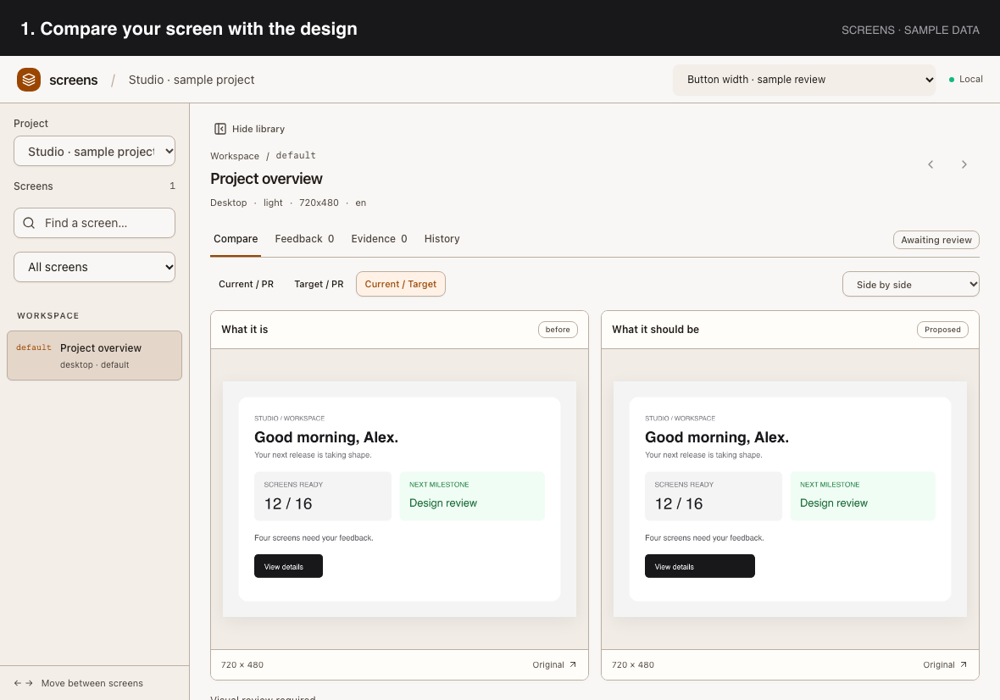

# Screens

**Compare screenshots. Leave feedback. Review the fix.**

Screens is a local review board for your app. Compare the current screen with
its design, click to leave feedback, and ask your AI coding assistant to fix it.
You decide when the result is ready.



*Actual Screens interface with sample data.*

## Get started

Open your app's project in your AI coding assistant and ask:

> Install Screens from https://github.com/verdictan/screens, connect it to this
> project, and open the review page. Load any existing screenshots.

Your assistant needs access to local files and commands.

Prefer manual setup? Install **Node.js 22.22.2+** and **Git**, then run:

```sh
git clone https://github.com/verdictan/screens.git
cd screens
node scripts/setup.mjs --project "/path/to/your-app" --start
```

Replace `/path/to/your-app` with your app's folder. Open
[localhost:4800](http://127.0.0.1:4800) and keep the terminal open.
Restart your AI assistant in your app's project to load the Screens tools.

## Review a screen

1. **Compare** the current screenshot with the design.
2. **Click the screenshot** to leave feedback.
3. **Ask your assistant** to fix the issue and add a new screenshot.
4. **Review the result** and accept it when you are satisfied.

Screens keeps earlier screenshots and their comments. Setup does not take
screenshots automatically; ask your assistant to prepare any that are missing.

## More help

- [Setup, imports, and commands](docs/usage.md)
- [Connect your AI assistant](docs/agent-skills.md)
- [Run with Docker](docs/deployment.md)
- [Review evidence](docs/evidence.md)
- [Tests and coverage](docs/testing.md)
- [Planned features](docs/roadmap.md)

Screens runs on your computer and has no account sign-in. Keep it local.
